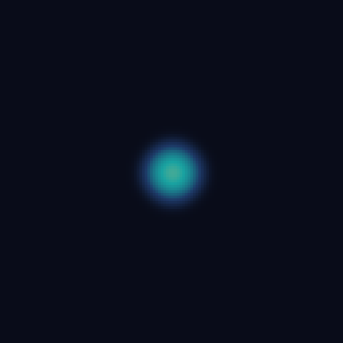

# SpiralPixcel 🌀

SpiralRealityのPixel実験ノートと、標準ターミナルのDebian VMでVulkan computeを動かすための小さな道具箱。

[端末設定と再開手順](docs/device.md) · [MITライセンス](LICENSE)

[任意の実験用セットアップ](docs/lab-session.md)：画面設定の保存・復元、Google同期の調整手順、描画応答チェック、VM側で期限を持つ短い実行と復旧コマンド。

## Pixelに指で描く

USB接続とペアリングが済んだMacで `pixel-lab draw`（リポジトリからは `./pixel-lab draw`）。Pixelの画面に好きな線を描き「保存して比較」を押すと、同じ軌跡を2つの係数で計算したGPU画像がPixelに戻る。[使い方・再現コマンド・実機画像](docs/touch.md)

## Macから実行

MacにPython 3.9以降・OpenSSH・Android Platform-Tools、Pixelの標準ターミナルにDebianとGPUアクセラレーションが必要。Debianで次を一度実行する。

    sudo apt-get update
    sudo apt-get install --no-install-recommends build-essential libvulkan-dev glslc openssh-server
    sudo systemctl start ssh

Macでこのリポジトリを開き、USB接続中に専用鍵を登録する。

    ./pixel-lab pair

表示されたコマンドをPixelのDebianで実行し、画面に出たホスト鍵の指紋をMacの `./pixel-lab trust SHA256:…` に渡す。次回からは、USBをつないでDebianを起動すれば続けられる。

    ./pixel-lab doctor

37×7個の32ビット整数をGPUで2倍し、259個すべてを期待値と照合する。GPU名、API、公開拡張、キュー、時間、入力・出力・シェーダーのハッシュを記録する。CPU型Vulkanデバイスでの実行は実機用コマンドでは失敗として扱う。CIは明示的にソフトウェアVulkanを許可する。

各実行の結果はMacのカレントディレクトリの `runs/<ID>/`、ソースと結果の控えはVMの `~/.local/share/SpiralPixcel/runs/<ID>/` に残る。回収だけやり直すには `./pixel-lab collect <ID>`。失敗時は `build-run.log` を見る。

## 2次元拡散で遊ぶ

Macで拡散係数を変え、同じ点刺激がどこまで広がるかを比べる。各回、MacのソースをPixelへ送り、VM内でシェーダーをコンパイルする。GLSLを編集した場合も同じコマンドで試せる。

    ./pixel-lab run diffusion
    ./pixel-lab run diffusion --rate 0.08
    ./pixel-lab run diffusion --steps 160 --rate 0.20 --decay 0.998

| 拡散係数 0.08 | 拡散係数 0.18 |
| --- | --- |
|  |  |

どちらもPixel 11 Proの標準Debian VM、128×128、中心に強さ1、96ステップ、各ステップの減衰係数0.995。同じ対数色スケールでGPU出力を表示した。拡散を強めると中央のピークは0.00644から0.00284に下がった。

- [整数の実機記録](examples/pixel-11-pro/doctor.json)
- [拡散係数0.08の実機記録](examples/pixel-11-pro/diffusion-008.json) と [係数0.18の実機記録](examples/pixel-11-pro/diffusion-018.json)
- [計算シェーダー](guest/shaders/diffusion.comp) と [CPU参照・画像出力](guest/diffusion.py)

拡散係数は0〜0.25、減衰係数は0〜1、ステップ数は1〜1024。端では最寄りのセルを使う。GPUで初期状態から1・中間・最終ステップまで個別に計算し、各時点の全セルを独立のCPU計算と比較する。最大絶対誤差2e-7以内で合格。更新則を変えるときはCPU参照も合わせる。

`field.png` がGPUの最終画像。`input.bin`・`gpu.bin`・`cpu.bin` は行優先・リトルエンディアンのfloat32で、途中の格子にはステップ数が付く。`gpu_ms` は各チェックポイントで初期値から計測したキュー上の区間、`submit_wait_ms` はVMからの投入・完了待ち、`host.json` はアップロードから回収までの時間。GPUのタイムスタンプが使えない場合は `gpu_ms: null` と記録する。

## モデルのdecodeとメモリを測る

`./pixel-lab run inference` でdoctorを通してから、既存モデルの速度・メモリ・モデルとランタイムのハッシュを記録する。[比較手順とPowerVR用の実験パッチ](docs/inference.md)

`--schedule-report` を付けると、速度測定とは別にCPU/GPUの演算配置を保存する。[128 MiB超の出力行列の分割](docs/large-output.md)と[転送検査・完了待ちの修正](docs/readback.md)も用意した。Qwen2.5-0.5Bの全GPU要求で固定プロンプトの数値ゲートを通過し、演算ごとに待つ対照からdecodeを改善した。CPU主体の方が速かった結果と、失敗した条件も保存している。

[符号なしdot積のmat-vec](docs/kernels.md)は、このGPUが高速に実行できる唯一の整数dot積を使う。同じランタイムで切り替えて交互に測ると、全GPU構成のdecodeは2.33倍（8.06→18.74 tok/s、数値ゲート通過）になった。[decodeの続き](docs/decode.md)では、転送ステージを含む高いバリア、ホストから見えるメモリへの配置、attentionスコアの小さいワークグループを直し、さらに1.51倍（18.89→28.56 tok/s、全logitはバイト単位で同じ）になった。CPU主体の構成にはまだ届かない。
