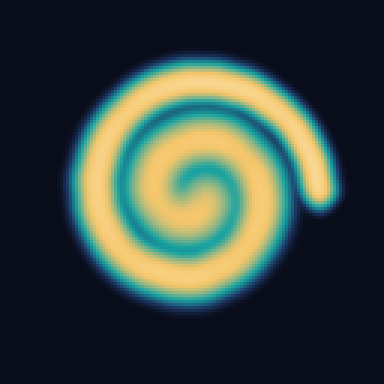
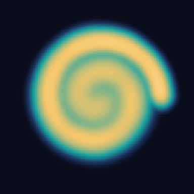

# 指で描いて拡散を比べる

USBでPixelを接続し、標準ターミナルのDebianを起動する。最初に一度だけ [MacとVMをペアリング](../README.md#macから実行) する。その後はMacで次を実行する。

    pixel-lab draw

リポジトリから直接使うときは `./pixel-lab draw`。Pixelのブラウザで四角の中に指で線を描く。触れてから最大10秒の間は、指を離して別の線を描き足せる。「保存して比較」を押すと、PowerVRが同じ軌跡を拡散係数0.08と0.18で再生する。左右の画像はCPU照合を通過した実機の最終格子。画面の「描き直す」で次の実験を始める。

Macのターミナルは開いたままにする。Ctrl-Cで描画セッションを閉じる。ページが見つからないときはPixelを解除し、Macに表示されたPixel用アドレスをその端末のブラウザで開く。描画ページはMacのループバックで動き、ADBのUSB逆転送でPixelに届く。描画と結果表示にはPixelとMacのUSB接続が必要。

## 軌跡を再利用する

「保存して比較」でMacのカレントディレクトリの `runs/touch-<ID>/trace.json` に元の軌跡が保存される。同じ場所の `comparison.json` に2条件の実行IDが順番に入る。計算や転送が中断した場合も、保存済みの軌跡を直接指定して再試行できる。個人の軌跡と生の格子を含む `runs/` はGitの管理外。

    pixel-lab run diffusion --trace runs/touch-<ID>/trace.json --rate 0.12 --steps 24

`--steps` は指を離した後の自由拡散回数。標準の描画比較は24回、減衰は0.995。生の軌跡・時刻ごとの刺激マスク・格子・PNG・CPUとの誤差を各実行に保存する。

## 公開サンプルで再現する

以下は4秒の渦巻きを数式で作った入力。リポジトリのルートで実行する。

    ./pixel-lab run diffusion --trace examples/touch/spiral.json --rate 0.08 --steps 24
    ./pixel-lab run diffusion --trace examples/touch/spiral.json --rate 0.18 --steps 24

| 係数0.08 | 係数0.18 |
| --- | --- |
|  |  |

[軌跡](../examples/touch/spiral.json) · [0.08の実機記録](../examples/touch/rate-008.json) · [0.18の実機記録](../examples/touch/rate-018.json)

## 再生規則

形式は `{"format":"SpiralPixcel.touch.v1","strokes":[[[0,64,64],[150,70,62]],[[300,90,90]]]}`。各点は最初の接触からの整数ミリ秒、x、yの順。座標は左上原点、各軸0〜127。一本の指を追い、各接触を別の配列にする。最大4096点。

空の格子から始め、50ミリ秒ごとに1回拡散・減衰させて、その区間で指が触れたセルを1にする。接触中の点間は位置と時刻を線形補間する。指が離れた隙間には刺激を足さない。最後の接触の後も指定回数だけ拡散する。CPUは訪問セル集合、GPUはそれを詰めたビット列を使う。最初・中間・最終の各時点と、最後の刺激の時点で全16,384セルを照合する。同じ時点は1回にまとめる。
